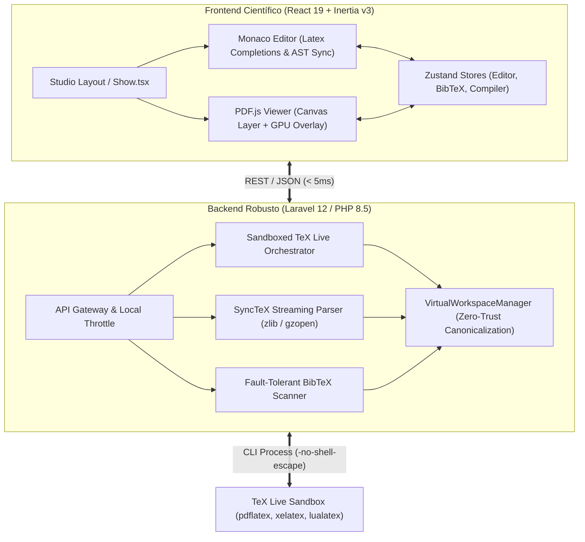

<div align="center">

# ⚡ paperForge
### *The Next-Generation Scientific Publishing & Local-First LaTeX Studio*

[](https://laravel.com)
[](https://react.dev)
[](https://inertiajs.com)
[](https://www.typescriptlang.org)
[](https://phpstan.org)
[](https://pestphp.com)
[](https://vitest.dev)
[](LICENSE)

<br />

<p align="center">
  <strong>paperForge</strong> es una estación de trabajo de grado científico de alto rendimiento diseñada para la redacción, compilación e inspección interactiva de documentos LaTeX. Combina un entorno <strong>100% Local-First / Zero-Trust</strong> con sincronización bidireccional código ↔ PDF en tiempo real, un motor AST tolerante a fallos, IntelliSense contextual y compilación sandboxed ultra rápida.
</p>

[✨ Características Principales](#-características-principales) •
[🏛️ Arquitectura del Sistema](#-arquitectura-del-sistema) •
[🚀 Instalación y Puesta en Marcha](#-instalación-y-puesta-en-marcha) •
[🧪 Certificación y QA](#-certificación-y-qa) •
[🔒 Modelo de Seguridad](#-modelo-de-seguridad) •
[👤 Autor](#-autor)

---

</div>

<br />

## 🌟 ¿Por qué paperForge?

Las herramientas tradicionales de edición LaTeX en la nube sufren de latencia de red, problemas de privacidad y dependencias externas de servidores remotos. Los editores de escritorio clásicos, por otro lado, carecen de interfaces modernas y sincronización fluida.

**paperForge** redefine la experiencia científica:
- 🚀 **Latencia Ultrabaja:** Round-trip de AST y parseo espacial en menos de 5 ms.
- 🔒 **Zero-Trust & Aislamiento Local:** Todo el procesamiento ocurre en tu máquina sin telemetría ni fugas de datos a terceros.
- 📐 **SyncTeX Bidireccional Acelerado por GPU:** Salta de cualquier línea de código a su caja tipográfica física en el PDF (y de doble clic en el Canvas de vuelta a tu editor) a 60 FPS ininterrumpidos.
- 🧠 **IntelliSense Científico:** Sugerencias $O(1)$ de claves BibTeX, etiquetas cruzadas (`\ref`), entornos tabulados (`\begin`) y macros sin sobrecargar el hilo principal.

---

## 🏛️ Arquitectura del Sistema



---

## ✨ Características Principales

### 1. 🎯 SyncTeX Espacial Bidireccional
- **Forward Sync (Código $\rightarrow$ PDF):** Presiona `F8` o `Ctrl+Shift+J` en Monaco para iluminar la posición exacta del párrafo en el visor PDF con una caja de resaltado translúcida que decae suavemente tras 1.5s (*Highlight Decay*).
- **Reverse Sync (PDF $\rightarrow$ Código):** Haz doble clic sobre cualquier palabra, ecuación o gráfico en el PDF para que el editor abra el archivo correspondiente y centre el cursor exactamente en la línea fuente (`revealLineInCenter`).
- **GPU-Accelerated Overlay:** Capa DOM independiente sobre el Canvas de `pdfjs-dist` para garantizar 60 FPS sin disparar repintados costosos de la página.

### 2. 📚 Motor BibTeX Tolerante a Fallos & Store Reactivo
- **Scanner $O(N)$ en Streaming:** Lee y procesa archivos `.bib` extrayendo metadatos estructurados (llaves, autores, años, journals) recuperándose automáticamente ante llaves desbalanceadas o sintaxis rota sin romper el hilo de ejecución.
- **IntelliSense Instantáneo:** Al tipear `\cite{`, `\citep{` o `\citet{`, Monaco despliega tarjetas enriquecidas con información bibliográfica con acceso sincrónico en memoria ($O(1)$).

### 3. 🧩 Motor AST Híbrido Bidireccional
- **Parser TypeScript Nativo:** Tokenizador, parser y serializador con tiempo de ejecución sub-200ms en documentos masivos de 50+ páginas.
- **Round-Trip Sin Pérdida de Datos:** Conserva intactos paquetes personalizados y macros no estándar (`UnknownBlockNode`).
- **Modos de Trabajo:** Alterna libremente entre vista de Código puro, Visual WYSIWYG o Vista Dividida (*Split Mode*).

### 4. 🛡️ Orquestador TeX Live Sandboxed
- **Aislamiento Seguro:** Ejecución forzada con `-no-shell-escape`, `-interaction=nonstopmode`, `-halt-on-error` y `-file-line-error`.
- **Detección Dinámica de Motores:** Soporte nativo para `pdflatex`, `xelatex` y `lualatex`.
- **Parser de Logs en Tiempo Real:** Extracción estructurada de errores, advertencias y números de línea desde los registros crudos de LaTeX.

---

## 🛠️ Stack Tecnológico

| Capa | Tecnologías |
| :--- | :--- |
| **Backend Framework** | [Laravel 12](https://laravel.com) / PHP 8.5 / PHP 8.3 |
| **Frontend Framework** | [React 19](https://react.dev), [Inertia.js v3](https://inertiajs.com) |
| **Estilos & UI** | [Tailwind CSS v4](https://tailwindcss.com), Radix UI, Lucide Icons |
| **Editor de Código** | [Monaco Editor](https://microsoft.github.io/monaco-editor/) + Custom LaTeX Language Provider |
| **Visor PDF** | [PDF.js (pdfjs-dist)](https://mozilla.github.io/pdf.js/) con worker local 100% offline |
| **Gestión de Estado** | [Zustand](https://github.com/pmndrs/zustand) |
| **Base de Datos** | [PostgreSQL](https://www.postgresql.org/) / SQLite (Testing) |
| **Compilador LaTeX** | TeX Live (`pdflatex`, `xelatex`, `lualatex`) + `synctex` |
| **Testing & QA** | [Pest PHP](https://pestphp.com), [Vitest](https://vitest.dev), [PHPStan](https://phpstan.org), [Laravel Pint](https://laravel.com/docs/pint) |

---

## 🚀 Instalación y Puesta en Marcha

### Prerrequisitos
- **PHP 8.3 o superior** (con extensiones `zlib`, `pdo_pgsql`, `mbstring`, `intl`)
- **Composer 2.x**
- **Node.js 20+** y **npm** / **pnpm**
- **PostgreSQL 14+**
- **TeX Live** instalado en el sistema (`sudo apt install texlive-full` o mínimo `texlive-latex-base texlive-binaries`)

### Pasos de Instalación

```bash
# 1. Clonar el repositorio
git clone git@github.com:vilteanibal/paperForge.git
cd paperForge

# 2. Instalar dependencias de PHP y JavaScript
composer install
npm install

# 3. Configurar variables de entorno
cp .env.example .env
php artisan key:generate

# 4. Configurar la base de datos en el archivo .env
# DB_CONNECTION=pgsql
# DB_HOST=127.0.0.1
# DB_PORT=5432
# DB_DATABASE=paperForge
# DB_USERNAME=tu_usuario
# DB_PASSWORD=tu_password

# 5. Ejecutar migraciones
php artisan migrate

# 6. Compilar assets frontend o iniciar servidor de desarrollo
npm run dev
# En otra terminal:
php artisan serve
```

---

## 🧪 Certificación y QA

**paperForge** cuenta con un pipeline de certificación unificado ejecutado bajo el comando `composer run qa`, garantizando el cumplimiento estricto de estándares industriales:

```bash
composer run qa
```

Este comando ejecuta de forma secuencial:
1. **Laravel Pint:** Formateo estricto de código bajo el estándar PSR-12.
2. **PHPStan (Nivel 8 Estricto):** Análisis estático exhaustivo con 0 errores permitidos.
3. **TypeScript Typecheck (`tsc --noEmit`):** Tipado estricto sin tipos `any` implícitos.
4. **Vitest Suite:** 33 pruebas unitarias y de integración de frontend (< 300 ms).
5. **Pest PHP Suite:** 127 pruebas unitarias y de integración backend (471 aserciones).

---

## 🔒 Modelo de Seguridad

El diseño de **paperForge** sigue una arquitectura **Zero-Trust** inmutable:

- **Border Patrol (Aislamiento de Rutas):** Todas las entradas de rutas relativas se interceptan mediante `SafeRelativePathRule`, denegando accesos que contengan `../`, rutas absolutas `/` o bytes nulos `\0` (HTTP 422).
- **Canonicidad en el VirtualWorkspace:** Todo archivo se resuelve a través de `VirtualWorkspaceManager::resolveCanonical()`, verificando mediante `realpath()` que el archivo jamás exceda la raíz asignada al proyecto (HTTP 403 Forbidden).
- **Prevención de RCE en TeX Live:** Todas las llamadas al proceso CLI deshabilitan las macros de ejecución mediante la bandera obligatoria `-no-shell-escape`.
- **Streaming Anti-OOM:** El parseo de archivos SyncTeX se realiza en bloques lineales de memoria mediante `gzopen()` y `gzgets()`, manteniendo el consumo de RAM por debajo de 5 MB incluso en libros de miles de páginas.

---

## 📖 Registros de Decisiones de Arquitectura (ADRs)

El proyecto documenta formalmente todas sus decisiones arquitectónicas clave en el directorio `docs/architecture/decisions/`:

- [`0001-virtual-workspace-isolation.md`](docs/architecture/decisions/0001-virtual-workspace-isolation.md) — Aislamiento del Workspace y Canonicidad Zero-Trust.
- [`0002-tex-live-sandboxing-and-process-orchestration.md`](docs/architecture/decisions/0002-tex-live-sandboxing-and-process-orchestration.md) — Sandboxing de Procesos TeX Live.
- [`0004-ast-parser-engine-and-lossless-serialization.md`](docs/architecture/decisions/0004-ast-parser-engine-and-lossless-serialization.md) — Motor AST y Serialización Inmutable.
- [`0008-bibtex-parser-and-reactive-cache.md`](docs/architecture/decisions/0008-bibtex-parser-and-reactive-cache.md) — Parseo Tolerante a Fallos de BibTeX.
- [`0009-monaco-intellisense-and-ast-label-extraction.md`](docs/architecture/decisions/0009-monaco-intellisense-and-ast-label-extraction.md) — IntelliSense Científico y Extracción de Etiquetas AST.
- [`0010-synctex-spatial-parsing-and-memory-streaming.md`](docs/architecture/decisions/0010-synctex-spatial-parsing-and-memory-streaming.md) — Parseo Espacial SyncTeX en Streaming Backend.
- [`0011-synctex-bidirectional-ui-and-coordinate-math.md`](docs/architecture/decisions/0011-synctex-bidirectional-ui-and-coordinate-math.md) — UI Bidireccional y Aceleración por GPU.

---

## 👤 Autor

Desarrollado y mantenido con pasión por la excelencia técnica por:

**Aníbal Vilte**  
*Fullstack Software Architect & Scientific Systems Engineer*  
- **GitHub:** [@vilteanibal](https://github.com/vilteanibal)  
- **Email:** [vilteanibal@gmail.com](mailto:vilteanibal@gmail.com)

---

<div align="center">
  <sub>Construido con precisión quirúrgica para la comunidad científica y académica. Distribuido bajo la Licencia MIT.</sub>
</div>
