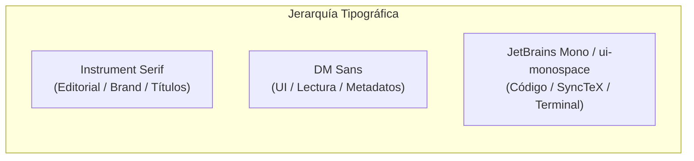

# 📜 Sistema de Identidad de Marca y Diseño: Paperforge

> **Paperforge** combina la calidez y el oficio de la tipografía editorial clásica y el papel físico con la precisión y el rigor de los entornos de desarrollo modernos para LaTeX y publicación científica.

---

## 1. Esencia y Personalidad de Marca

| Atributo | Definición |
| :--- | :--- |
| **Nombre de Marca** | `paperforge` (Wordmark en minúsculas) |
| **Monograma / Isotipo** | `P` serifa en un contenedor circular terracota |
| **Arquetipo** | *El Artesano Académico* (The Academic Craftsman) / *El Tipógrafo de Vanguardia* |
| **Propósito** | Cerrar la brecha entre el código fuente riguroso y la experiencia táctil de maquetación en papel |
| **Valores Clave** | Calidez táctil, precisión técnica, serenidad visual, legibilidad editorial, atención al detalle |
| **Tono de Voz** | Sereno, académico, directo, refinado, libre de artificios tecnológicos estridentes |

---

## 2. Paleta Cromática y Tokens de Color

La identidad se fundamenta en tonos cálidos derivados del papel pergamino, lino crudo, grafito y acentos terracota / cobre rústico.

### 2.1 Colores Principales (Brand & UI Neutrals)

```
┌─────────────────┐ ┌─────────────────┐ ┌─────────────────┐ ┌─────────────────┐
│  Terracotta     │ │  Copper Rust    │ │  Warm Parchment │ │  Espresso Ink   │
│  #D88F6D        │ │  #BB6D4C        │ │  #FFFEFA        │ │  #322F2C        │
│  --ui-accent    │ │  --ui-accent-dp │ │  --paper        │ │  --ui-ink       │
└─────────────────┘ └─────────────────┘ └─────────────────┘ └─────────────────┘
```

| Token CSS | HEX | Rol de Diseño |
| :--- | :--- | :--- |
| `--ui-accent` | `#d88f6d` | Acento principal, selecciones activas, foco visual |
| `--ui-accent-deep` | `#bb6d4c` | Botón de compilación/acción principal, enlaces activos, badges |
| `--ui-accent-soft` | `#f3e1d8` | Fondo de elementos seleccionados o activos en modo claro |
| `--paper` | `#fffefa` | Hoja de manuscrito / papel físico |
| `--paper-ink` | `#39332d` | Texto principal sobre el papel editorial |
| `--paper-muted` | `#8a8179` | Metadatos del documento, números de figura, subtítulos |
| `--paper-rule` | `#d9c6bb` | Líneas divisorias sutiles sobre el papel |

### 2.2 Superficies de la Interfaz (Light Mode)

| Token CSS | HEX | Uso |
| :--- | :--- | :--- |
| `--ui-bg` | `#efedeb` | Fondo general de la aplicación |
| `--ui-surface` | `#f8f6f3` | Barras superiores, tarjetas, modales y cabeceras |
| `--ui-surface-strong`| `#e8e4df` | Fondos de hover, contenedores de iconos |
| `--ui-surface-soft` | `#f3f0ed` | Inputs, pills de estado, selectores |
| `--ui-border` | `#d7d2cc` | Bordes primarios de paneles |
| `--ui-border-strong` | `#c7c0ba` | Separadores destacados y bordes de diálogo |
| `--ui-ink` | `#322f2c` | Texto principal de la interfaz |
| `--ui-muted` | `#827c76` | Texto secundario y leyendas |
| `--ui-muted-strong` | `#655f5a` | Etiquetas con peso visual |

### 2.3 Riel Lateral y Superficies de Contraste (Dark Rail & Code)

| Token CSS | HEX | Uso |
| :--- | :--- | :--- |
| `--ui-rail` | `#3f3d3b` | Barra lateral izquierda (Rail de navegación) |
| `--ui-rail-soft` | `#4b4845` | Panel de explorador de archivos / estructura |
| `--ui-rail-text` | `#e8e2dc` | Texto en paneles oscuros |
| `--ui-rail-muted` | `#a9a19a` | Iconos inactivos en paneles oscuros |
| `--code-bg` | `#292927` | Superficie del editor de código |
| `--code-header` | `#3f3d3a` | Barra superior del editor de código |

### 2.4 Acentos Semánticos y Estados

| Token | HEX (Claro) | HEX (Oscuro) | Uso |
| :--- | :--- | :--- | :--- |
| `--ui-green` | `#719b7b` | `#8eb497` | Estado "Conectado", compilación exitosa, guardado |
| `--ui-green-soft`| `#e3eee5` | `#314538` | Badges y notificaciones de éxito |
| `--ui-amber` | `#b7854e` | `#ddb071` | Advertencias de LaTeX, compilando en progreso |
| `--ui-amber-soft`| `#f4eadc` | `#4d4030` | Píldoras de advertencia |
| `--ui-red / Error`| `#b95e48` | `#e77c68` | Errores de compilación, fallos de guardado |
| `--ui-red-soft` | `#fbece9` | `#472b27` | Alertas de error |

---

## 3. Tipografía y Escala Editorial

La identidad tipográfica se estructura en un maridaje de alto contraste entre una **Serifa Editorial** expresiva y una **Sans-Serif Grotesca** limpia y funcional.



### 3.1 Fuentes Oficiales

1. **Instrument Serif** (`@fontsource/instrument-serif`)
   - **Estilo:** Serif clásica, elegante, de bajo tracking y alta densidad tipográfica.
   - **Aplicación:** Logotipo `paperforge`, títulos de nivel 1 y 2 en el papel, encabezados de modales, fórmulas matemáticas integradas.
   - **Reglas:** Utilizar siempre con `letter-spacing: -0.03em` a `-0.04em` y `line-height: 0.95` a `1.0`.

2. **DM Sans** (`@fontsource/dm-sans` – Pesos 400, 500, 600, 700)
   - **Estilo:** Neo-grotesca geométrica legible, contemporánea y neutra.
   - **Aplicación:** Textos de lectura del manuscrito, botones de navegación, menús contextuales, etiquetas *eyebrow*, metadatos.

3. **JetBrains Mono / Monospace**
   - **Aplicación:** Editor de código LaTeX, consola de errores, referencias de línea y SyncTeX.

### 3.2 Escala Tipográfica de Referencia

| Elemento | Fuente | Tamaño | Peso | Tracking / Espaciado |
| :--- | :--- | :--- | :--- | :--- |
| **Wordmark (Logo)** | Instrument Serif | `25px` | 400 | `-0.035em` |
| **Título de Papel (H1)** | Instrument Serif | `clamp(44px, 5vw, 62px)` | 400 | `-0.04em`, line-height `0.95` |
| **Sección de Papel (H2)** | Instrument Serif | `31px` | 400 | `-0.02em`, line-height `1.0` |
| **Título Modal / Diálogo** | Instrument Serif | `31px` | 400 | `-0.02em` |
| **Párrafo Editorial** | DM Sans | `12.5px` | 400 | Normal, line-height `1.73` |
| **Eyebrows / Kicker** | DM Sans | `9px` | 700 | `+0.16em` (Uppercase) |
| **Botones y Menús** | DM Sans | `10px - 11px` | 600 / 700 | Normal |
| **Status / Microcopia** | DM Sans | `9px - 10px` | 500 | `+0.07em` |
| **Código / Líneas** | JetBrains Mono | `12px` | 400 | Line-height `1.72` |

---

## 4. Iconografía y Elementos Visuales

- **Librería Base:** `@phosphor-icons/react`
- **Variantes Empleadas:** `duotone` para navegación lateral y herramientas principales; `regular` y `fill` para estados interactivos (como el botón de guardar activo).
- **Tratamiento Visual:**
  - Los iconos nunca se presentan sobrecargados; cuentan con áreas de clic cuadradas compactas (`28px x 28px` o `36px x 34px` en riel).
  - Efectos hover suaves con fondo translúcido y cambio hacia el acento terracota.

---

## 5. Anatomía de Componentes Distintivos

### 5.1 El Manuscrito Táctil ("The Paper")
El lienzo principal simula una hoja de papel físico sobre un fondo lino:
- **Fondo:** `#fffefa` con un borde sutil `1px solid rgba(105, 93, 83, 0.14)`.
- **Sombra física:** `box-shadow: 0 18px 46px rgba(58, 50, 43, 0.13), 0 2px 6px rgba(58, 50, 43, 0.08)`.
- **Regla de autor:** Línea horizontal de `80px` de ancho por `2px` de alto en color `--ui-accent` (`#d88f6d`).
- **Bloque de Resumen (Abstract):** Caja con fondo crema `#fcf8f3` y borde izquierdo de `2px` en `--paper-rule`.

### 5.2 Barra de Navegación Dual (TopBar)
1. **Piso Superior (`topbar-main`, 43px):**
   - Wordmark en `Instrument Serif` + separador vertical delgado (`1px x 18px`).
   - Nombre del proyecto + píldora redondeada (`local-pill`) con punto verde o indicador de estado de sincronización.
   - Selector de motor LaTeX embebido (LuaLaTeX / XeLaTeX / pdfLaTeX) con tipografía a `10px`.
   - Botón de Compilación principal: terracota `#bb6d4c` con icono `Play` y texto blanco.
2. **Piso Inferior (`topbar-nav`, 34px):**
   - Menús tipo suite de escritorio clásica: `Archivo`, `Editar`, `Insertar`, `Ver`.
   - Conmutador de modos segmentado: `Visual` | `Código` | `Dividido` (Split).

### 5.3 Riel Lateral Izquierdo (Rail)
- Ancho fijo de `60px`, color grafito cálido `#3f3d3b`.
- Isotipo superior: Círculo de `27px` color `#d88f6d` con letra `P` oscura.
- Botones de acción vertical centrados con indicador activo lateral izquierdo (`box-shadow: inset 2px 0 0 var(--ui-accent)`).

### 5.4 Diálogos y Paleta de Comandos
- **Backdrop:** `rgba(43, 39, 35, 0.44)` con desenfoque `backdrop-filter: blur(3px)`.
- **Contenedores:** Esquinas redondeadas de `10px`, bordes finos `#c7c0ba`, sombra profunda `0 24px 65px rgba(36, 31, 27, 0.25)`.
- **Encabezados:** Subtítulo *eyebrow* en mayúsculas espaciadas + Título grande en `Instrument Serif`.

---

## 6. Microinteracciones y Estados

- **Foco Accesible:** `outline: 2px solid var(--ui-accent); outline-offset: 2px;`.
- **Transiciones:** Suaves y directas (`150ms` a `180ms ease`).
- **Toasts:** Notificaciones fijas en la esquina inferior derecha (`bottom: 47px; right: 24px`) con animación de entrada ascendente (`toast-in: translateY(6px) -> translateY(0)`).
- **Indicador de cambios sin guardar:** La píldora de tiempo y el icono de guardado cambian sutilmente a naranja cálido (`#d97736`).

---

## 7. Paquete de Tokens para Replicar

### 7.1 Variables CSS Nativas (`theme.css`)

```css
:root {
  /* Tipografía */
  --font-serif: "Instrument Serif", Georgia, serif;
  --font-sans: "DM Sans", -apple-system, BlinkMacSystemFont, "Segoe UI", sans-serif;
  --font-mono: "JetBrains Mono", ui-monospace, SFMono-Regular, Menlo, monospace;

  /* Colores de Interfaz (Modo Claro) */
  --ui-bg: #efedeb;
  --ui-surface: #f8f6f3;
  --ui-surface-strong: #e8e4df;
  --ui-surface-soft: #f3f0ed;
  --ui-border: #d7d2cc;
  --ui-border-strong: #c7c0ba;
  --ui-ink: #322f2c;
  --ui-muted: #827c76;
  --ui-muted-strong: #655f5a;

  /* Acentos de Marca */
  --ui-accent: #d88f6d;
  --ui-accent-deep: #bb6d4c;
  --ui-accent-soft: #f3e1d8;

  /* Riel y Paneles Oscuros */
  --ui-rail: #3f3d3b;
  --ui-rail-soft: #4b4845;
  --ui-rail-text: #e8e2dc;
  --ui-rail-muted: #a9a19a;

  /* Lienzo de Papel */
  --paper: #fffefa;
  --paper-ink: #39332d;
  --paper-muted: #8a8179;
  --paper-rule: #d9c6bb;
  --shadow-paper: 0 18px 46px rgba(58, 50, 43, 0.13), 0 2px 6px rgba(58, 50, 43, 0.08);

  /* Semántica */
  --ui-green: #719b7b;
  --ui-green-soft: #e3eee5;
  --ui-amber: #b7854e;
  --ui-amber-soft: #f4eadc;
  --ui-red: #b95e48;
}

/* Modo Oscuro */
.theme-dark {
  --ui-bg: #282726;
  --ui-surface: #33312f;
  --ui-surface-strong: #44413e;
  --ui-surface-soft: #3b3937;
  --ui-border: #4c4844;
  --ui-border-strong: #5e5954;
  --ui-ink: #f2eee8;
  --ui-muted: #aaa39c;
  --ui-muted-strong: #d1c9c1;
  --ui-accent: #e09a77;
  --ui-accent-deep: #eca987;
  --ui-accent-soft: #4d3931;
  --paper: #f9f5ef;
  --paper-ink: #39332d;
  --paper-muted: #817a72;
  --shadow-paper: 0 18px 54px rgba(0, 0, 0, 0.32), 0 2px 6px rgba(0, 0, 0, 0.2);
}
```

### 7.2 Configuración para Tailwind CSS (`tailwind.config.js`)

```javascript
/** @type {import('tailwindcss').Config} */
export default {
  theme: {
    extend: {
      colors: {
        paperforge: {
          accent: {
            DEFAULT: '#d88f6d',
            deep: '#bb6d4c',
            soft: '#f3e1d8',
          },
          ink: {
            DEFAULT: '#322f2c',
            muted: '#827c76',
            strong: '#655f5a',
          },
          surface: {
            bg: '#efedeb',
            DEFAULT: '#f8f6f3',
            strong: '#e8e4df',
            soft: '#f3f0ed',
          },
          rail: {
            DEFAULT: '#3f3d3b',
            soft: '#4b4845',
            text: '#e8e2dc',
            muted: '#a9a19a',
          },
          paper: {
            DEFAULT: '#fffefa',
            ink: '#39332d',
            muted: '#8a8179',
            rule: '#d9c6bb',
          },
        },
      },
      fontFamily: {
        serif: ['"Instrument Serif"', 'Georgia', 'serif'],
        sans: ['"DM Sans"', 'system-ui', 'sans-serif'],
        mono: ['"JetBrains Mono"', 'monospace'],
      },
      boxShadow: {
        paper: '0 18px 46px rgba(58, 50, 43, 0.13), 0 2px 6px rgba(58, 50, 43, 0.08)',
        modal: '0 24px 65px rgba(36, 31, 27, 0.25)',
      },
    },
  },
};
```

---

## 8. Guía Rápida para Nuevas Implementaciones

1. **Instalación de Tipografías:**
   ```bash
   npm i @fontsource/dm-sans @fontsource/instrument-serif @phosphor-icons/react
   ```
2. **Jerarquía Visual:** Mantener las vistas con contraste estructural: navegación periférica sobria y oscura (`#3f3d3b`) o neutra cálida (`#efedeb`), centrando la atención en el contenedor editorial o manuscrito blanco pergamino (`#fffefa`).
3. **Botones Principales:** Utilizar siempre `--ui-accent-deep` (`#bb6d4c`) con texto en blanco roto (`#fffaf6`) y borde redondeado sutil (`5px`).
4. **Tratamiento de Títulos:** Nunca usar fuentes sans-serif genéricas para encabezados clave; utilizar siempre `Instrument Serif` en tamaño generoso y *letter-spacing* negativo para evocar la tradición tipográfica.
